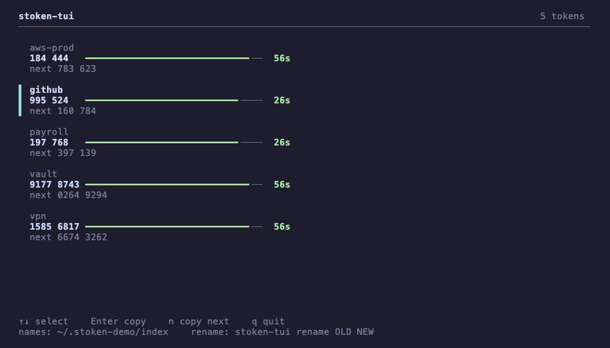
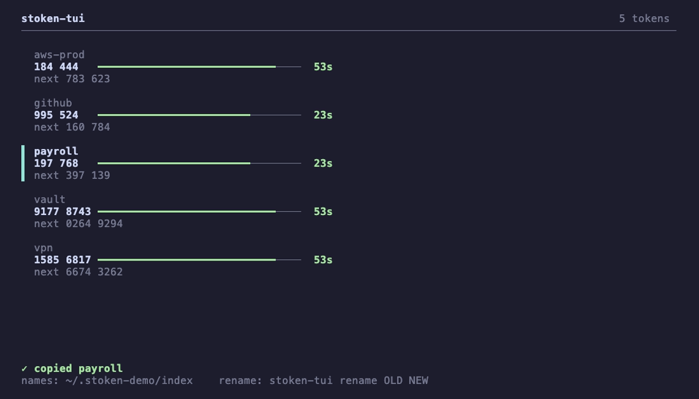
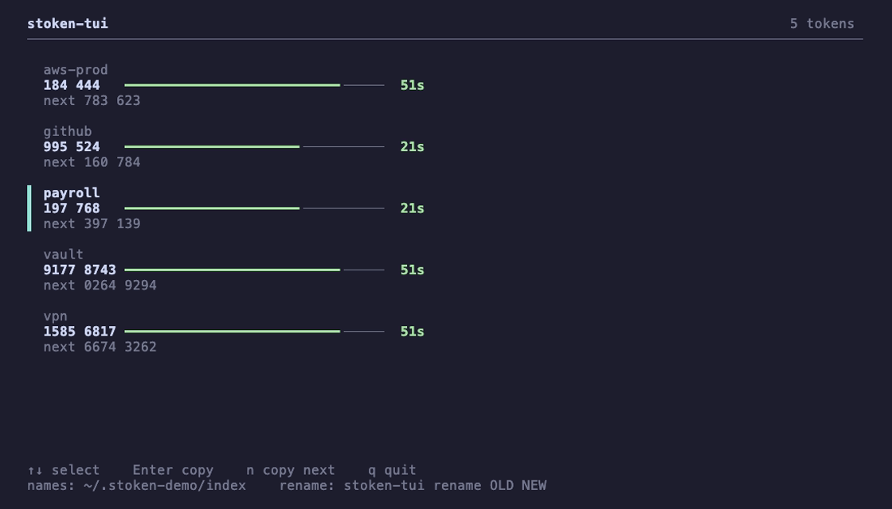
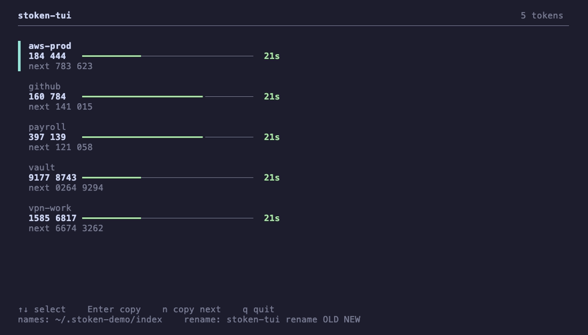

<h1 align="center">stoken-tui</h1>

<p align="center">
  Your RSA SecurID tokens in the terminal, laid out like a TOTP app. Every code at once, a countdown on each, seeds in the macOS Keychain behind Touch ID.
</p>

<p align="center">
  <a href="https://github.com/STRML/stoken-tui/actions/workflows/test.yml"></a>
  
  
  
  <a href="LICENSE"></a>
</p>

<p align="center">
  
</p>

RSA SecurID software tokens don't fit any standard authenticator app. [stoken](https://github.com/stoken-dev/stoken) generates the codes, but it handles one token per file and asks for a password on every run. `stoken-tui` keeps every token in the Keychain, reads them all at once, and shows each code under its name with the seconds it has left.

```
by hand   stoken tokencode --rcfile work.rc ─▶ password ─▶ repeat per token
with it   stoken-tui ─▶ Touch ID ─▶ every code, counting down
```

## Install

You need macOS, [stoken](https://github.com/stoken-dev/stoken) (`brew install stoken`) and Python 3.9 or later. The Touch ID helper compiles once with `swiftc`, which comes with the Xcode command line tools (`xcode-select --install`). There are no Python dependencies. Importing an activation link also needs `rsa_ct_kip` (`uv tool install rsa-ct-kip`), described under "Getting a token in the first place".

```sh
git clone https://github.com/STRML/stoken-tui
ln -s "$PWD/stoken-tui/stoken-tui" ~/.local/bin/
```

Any directory on your `PATH` works in place of `~/.local/bin`.

## Use

Add a token, then run `stoken-tui`.

```sh
stoken-tui add                                # asks for a name, then the token
stoken-tui add work --file work.sdtid         # a file from your admin
pbpaste | stoken-tui add vpn --token -        # an activation link or CTF string
stoken-tui adopt old ~/.stokenrc              # a token stoken already holds
stoken-tui
```

<p align="center"><br><sub>every code at once, the selected one marked</sub></p>

<p align="center"><br><sub>Enter copies the selected code</sub></p>

<p align="center"><br><sub>n copies the next code</sub></p>

<p align="center"><br><sub>stoken-tui rename vpn vpn-work</sub></p>

The bar and the seconds go green, then yellow under 20 seconds, then red under 10. The code a token will show next sits under the current one, so you can read it before it appears.

| Key | Action |
|---|---|
| <kbd>↑</kbd> <kbd>↓</kbd> or <kbd>j</kbd> <kbd>k</kbd> | Move the selection |
| <kbd>Enter</kbd> or <kbd>c</kbd> | Copy the selected code |
| <kbd>n</kbd> | Copy the selected token's next code |
| <kbd>a</kbd> | Add a token |
| <kbd>q</kbd> or <kbd>Esc</kbd> | Quit |

A copied code leaves the clipboard after 30 seconds, or when you quit, if nothing else has replaced it.

### Next codes

An RSA server that doubts a login can ask for the next code, not the current one. The next code is the one a token shows one interval from now (60 seconds on most tokens). `n` copies it, and the same code is one command away:

```sh
stoken-tui code work --next
```

### The commands

| You want to | Run |
|---|---|
| See every code, live | `stoken-tui` |
| Add a token, step by step | `stoken-tui add`, or <kbd>a</kbd> in the live view |
| Add a token from a file | `stoken-tui add NAME --file token.sdtid` |
| Add a token from a link or CTF string | `pbpaste \| stoken-tui add NAME --token -` |
| Move in a token that stoken already holds | `stoken-tui adopt NAME ~/.stokenrc` |
| Print one code | `stoken-tui code NAME` (`--next` for the next one) |
| Rename a token | `stoken-tui rename OLD NEW`, or `r` in the live view |
| Print the stored seed | `stoken-tui export NAME` |
| Remove a token | `stoken-tui rm NAME` (`--purge` also deletes its seed) |

`add` asks for whatever you left out: the name, then the token (shown as you type; paste a link or a CTF string, or drop in the path of an `.sdtid` file), then the PIN. Names may hold spaces (`my vpn`) and 64 characters at most. Press Enter at the PIN if the token has none. `adopt` asks for a PIN too.

Don't edit the name list by hand. The footer shows where it lives (`~/.stoken/index`), but each name is also the Keychain account that holds the seed, so changing one without the other loses the token. `rename` (and `r` in the live view, which asks for the new name and runs the same code) changes both.

## Touch ID

The live view, `code` and `export` ask for Touch ID before they read anything. Your login password and an Apple Watch work too. `add`, `adopt`, `rename` and `rm` don't ask. The first run compiles `touchid.swift` into `~/.cache/stoken-tui` and reuses the result.

Set `STOKEN_TUI_AUTH=off` to skip the prompt, for example over ssh, where no dialog can appear.

This guards the app, not the Keychain item. Any process running as you can still read the item with `security`.

## How it works

```
before   token ─▶ rc file ─▶ random password ─▶ Keychain     two encrypted stores per token
now      token ─▶ seed in the Keychain ─▶ stoken reads it from a pipe
```

The seed is the only secret, and a code is a function of the seed and the time. So the seed sits in the Keychain as stoken's plain 81-digit string, one item per name (a PIN, if the token has one, is a second item). stoken gets the seed on a pipe file descriptor and the PIN on stdin. No token file, password or temp file exists, and a seed never appears in a command line or the environment.

`~/.stoken/index` holds the names and nothing else, because the Keychain can't list items by service.

<details>
<summary><b>Why not curses</b></summary>

<br>

The view draws with plain ANSI escape sequences. In a UTF-8 session, ncurses' repeat-character optimization wrote a stray `0x01` byte before `ESC[Nb` for a run of the heavy bar glyph, which leaves gaps in some terminals. Python's curses also draws nothing but `?` for non-ASCII until `setlocale` runs. A single write per tick over the alternate screen avoids both. Set `STOKEN_TUI_ASCII=1` if your terminal can't draw box characters.

</details>

<details>
<summary><b>Back up and recovery</b></summary>

<br>

The login keychain is the only store, and Time Machine backs it up with your home directory. Your macOS login password protects it. Keep the original token too: the `.sdtid` file, or the activation link or CTF string. `stoken-tui export NAME` prints the stored seed, and `add --token -` accepts it back.

`rm` keeps the seed in the Keychain under `NAME.trashed-<epoch>`, so a removed token can come back. `rm --purge` deletes it.

</details>

<details>
<summary><b>Getting a token in the first place</b></summary>

<br>

An admin may send a link like `com.rsa.securid://ctkip?url=...&activationCode=...`. Paste it into `stoken-tui add`. The link carries a one-time code and a server address, and stoken-tui trades them for the token through [rsa_ct_kip](https://github.com/dlenski/rsa_ct_kip) (`uv tool install rsa-ct-kip` or `pipx install rsa-ct-kip`, which put `rsa_ct_kip` on your PATH; or point `STOKEN_TUI_CTKIP` at its script). Homebrew's Python refuses a bare `pip install`, so use one of those two.

```
link ─▶ checks ─▶ you confirm the host ─▶ rsa_ct_kip ─▶ recovery.sdtid ─▶ Keychain ─▶ folder deleted
                                          (code on stdin)  (private folder)  (read back)
```

The code works once, so:

1. Save the original link in your password manager before you paste it.
2. Don't tap the link on a phone that has the RSA app. The app would use the code first.
3. If a step after the server's answer fails, the folder stays under `~/.cache/stoken-tui/ctkip-*` and the message names it. `stoken-tui add NAME --file <that folder>/recovery.sdtid` finishes the job. Trash the folder once the token works.

| stoken-tui does | Because |
|---|---|
| Accepts an `https` address and a plain code, nothing else | Both values go to another program |
| Shows the host and asks `[y/N]` before it spends the code | A link from a stranger should not get one |
| Sends the code on stdin | argv shows up in `ps` |
| Never prints the seed, and keeps `recovery.sdtid` until the Keychain read-back passes | The server hands the seed out once |
| Discards the result when the server's MAC does not verify | rsa_ct_kip exits 0 and writes a token anyway |
| Renames the `DefAddPin` tag rsa_ct_kip writes to `DefAddPIN` ([dlenski/rsa_ct_kip#11](https://github.com/dlenski/rsa_ct_kip/pull/11)) | Without it a PINless token asks for a PIN |

rsa_ct_kip claims to be RSA's own client, and your issuer's policy may not allow that. Read its source before the first run.

</details>

## What it relies on

| Need | Source |
|---|---|
| The codes | `stoken tokencode`, with the next code as `--use-time` one interval ahead |
| Seed in, no file | `stoken ... --file=/dev/fd/N` |
| Seed storage | the macOS login keychain, through `security -i` with the value hex-encoded |
| The prompt | `LocalAuthentication`, through a 40-line Swift helper |

## Limits

- Touch ID guards the app. Any process running as you can read the Keychain item through `security`.
- The login keychain file sits in your home directory and its backups. Against someone holding those files, the protection is your macOS login password.
- `export` prints the seed to the terminal, so it can land in scrollback.
- A password-protected `.sdtid` can't be added directly. Decrypt it with stoken first, then `adopt` it.
- It doesn't talk to RSA's activation servers. Use rsa_ct_kip for that.

## Tests

```sh
python3 tests/e2e.py
```

The suite runs 34 scenarios against a temporary directory and a throwaway Keychain service, with `stoken` and `pbcopy` wrapped in shims that log every call. It checks what reached each command line (no seed, PIN or password may), what ended up on disk (no seed anywhere), and what the screen looks like in a real tmux pane. It needs the real `stoken`, `security` and `tmux`, and Touch ID is stubbed out.

A passing suite says little if a scenario can't fail. `python3 tests/mutants.py` breaks the tool in 18 named ways, one line each, and checks that the scenario guarding each one goes red. A full run takes about 40 minutes, so it isn't part of CI. `--check` confirms the mutations still apply to the source in a second.

The screenshots and the animation come from made-up tokens. `demo/fixture.py` builds five of them with different intervals, and `vhs demo/demo.tape` re-renders everything. The design notes and the failure matrix behind each scenario are in [docs/plan.md](docs/plan.md).

## License

[MIT](LICENSE)
